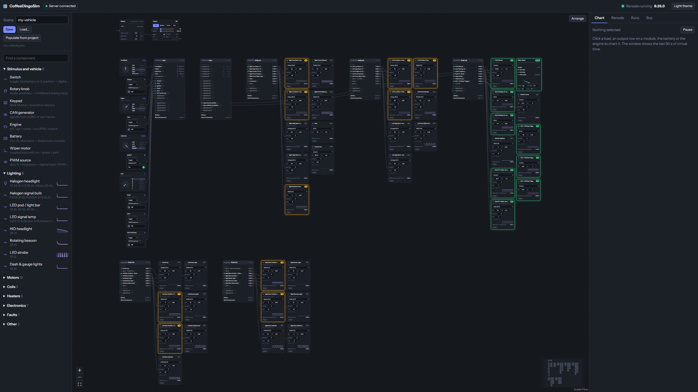

[](https://github.com/Coffee0297/CoffeeDingoFW/releases)
[](https://github.com/corygrant/dingoFW)
[](https://corygrant.github.io/dingoPDM/)

# CoffeeDingoFW

Firmware for the **dingoPDM v7**, **dingoPDM-Max v1** and **CANBoard v2**: a fork of
[corygrant/dingoFW](https://github.com/corygrant/dingoFW) that adds firmware updates over CAN, embedded Lua,
PWM inputs, timers, lookup tables, an on-board trip log and a set of CAN robustness fixes. The dingoPDM is an
Infineon Profet based power distribution module; the CANBoard adds analog/digital inputs and four low-side
outputs to the same CAN bus. ChibiOS RT on an STM32F446 (PDMs) or STM32F303 (CANBoard).

It is configured with **[CoffeeDingoConfig](https://github.com/Coffee0297/CoffeeDingoConfig)** (≥ v0.8.0 for
v5.5.108 and later) and can be run off the car, unchanged, in **[CoffeeDingoSim](https://github.com/Coffee0297/CoffeeDingoSim)**:
the screenshot below is this firmware running seven modules of a whole vehicle on a PC.



**Latest release: [v5.5.111](https://github.com/Coffee0297/CoffeeDingoFW/releases)** (`CONFIG_VERSION` 0x0011),
see the [CHANGELOG](CHANGELOG.md). Flashing it over a different config version resets the module's saved
settings to defaults: deploy your project again from dingoConfig afterwards.

## Compared with the original dingoFW

The fork branched from upstream `master` at `06cb9e3` (2026-05-16). Upstream issue numbers (#52, #61) were
design discussions there, not merged code. ✅ = present, ❌ = absent.

| Feature | Original | This fork | Notes |
|---|---|---|---|
| Boards dingoPDM v7, dingoPDM-Max v1, CANBoard v2 | ✅ | ✅ | |
| PT-DPDM4 board, NeoPixel LEDs | ✅ | ❌ | Added upstream after the fork point |
| Firmware update over USB DFU | ✅ | ✅ | BOOT0 or the software trigger |
| **Firmware update over CAN** (OpenBLT XCP bootloader) | ❌ | ✅ | Bootloader installed once (SWD/DFU), then every app update over CAN from dingoConfig |
| **Embedded Lua** (PDMs) with CAN tx/rx, timers, 32 output slots | ❌ | ✅ | Lua 5.5, `lua/`; upload, read-back and error read-back over CAN |
| **PWM input** on digital inputs (duty %, Hz, glitch filter) | ❌ | ✅ | v5.5.108; frequency capped per board from its input circuit |
| Analog: calibrated multi-position switch (≤ 10 positions), linear sensor scaling | ❌ | ✅ | Replaces the uniform offset/step rotary |
| Outputs: current limit, inrush, reset modes, PWM, soft start | ✅ | ✅ | |
| PWM output frequency from a signal, duty slew | ❌ | ✅ | |
| PWM on the CANBoard's DO1–DO4 | ❌ | ✅ | One timer per output |
| Warn limit / open-load detection | ❌ | ✅ | Report only; the output keeps running |
| **Trip log** with the current waveform around each trip | ❌ | ✅ | Read over CAN |
| Output bench test (force on / PWM for a bounded hold) | ❌ | ✅ | |
| Conditions, counters, flashers, virtual inputs, CAN in/out, keypads, wiper, starter | ✅ | ✅ | |
| Condition hysteresis (separate release point) | ❌ | ✅ | |
| **Timers** (on-delay / off-delay / pulse) | ❌ | ✅ | |
| **Lookup tables** (up to 8×8, bilinear) | ❌ | ✅ | PDMs |
| Auto-sleep | ✅ | ✅ | CANBoard v2 too from v5.5.111 (wakes on its digital inputs and CAN) |
| Force-sleep / mute-TX inputs, per-pin wake sources, outputs off on sleep | ❌ (`development` branch only) | ✅ | |
| CAN: full RX FIFO drain, 48-frame CANBoard mailbox, no-ACK retransmit back-off | ❌ | ✅ | No more frame loss on a busy bus |
| Param protocol: WriteAll, CheckCrc | ✅ | ✅ | |
| Refused single param write gets a reply | ❌ | ✅ | Upstream stays silent |
| CANBoard built as Cortex-M4F (hardware FPU, `-Os`, CCM) | ❌ | ✅ | Frees the flash for the features above |
| Host self-test, bench flasher (SWD + USB, release download) | ❌ | ✅ | `tests/host_selftest.cpp`, `flash-dingo.ps1` |

The original's unreleased `development` work since the fork point (multi-bus draft, params in their own
thread, live CAN filter updates, chunked FRAM writes) is not in this fork. The two `CONFIG_VERSION` lines are
independent (upstream 0x0006/0x0007, here 0x0011), so moving a module between the two resets its config.

## Guide

### 1. Get the firmware
Download the files for your board from the [releases](https://github.com/Coffee0297/CoffeeDingoFW/releases)
(`.bin` / `.hex` for USB or SWD, `.srec` for CAN), or build it:

```bash
# ARM GNU toolchain on PATH (arm-none-eabi-gcc 13.x). Build from bash, not cmd.exe.
make clean && make BOARD=dingopdm_v7      # or dingopdmmax_v1, canboard_v2
# -> build/<board>.bin / .hex / .elf / .srec
g++ -std=c++20 -DDINGO_HOST_TEST -I functions -I core tests/host_selftest.cpp functions/table.cpp functions/timer.cpp -o build/host_selftest && build/host_selftest
```

### 2. Flash a module
- **dingoPDM / -Max over USB:** hold BOOT0 (or use dingoConfig's *Flash over USB*), the board appears in DFU,
  dingoConfig writes the `.bin`.
- **First install of the CAN bootloader:** once per board, with
  [`flash-dingo.ps1`](#flashing-boards-with-flash-dingops1): it downloads the release and installs bootloader +
  firmware over SWD (CANBoard) or USB-C (PDM, no BOOT0 needed when it is running firmware), one board or a
  batch. Background in [Firmware update over CAN](#firmware-update-over-can-openblt) below.
- **Every update after that, over CAN:** dingoConfig ▸ System ▸ *Flash over CAN* ▸ pick the `.srec`. No USB,
  the module stays in the car, and an interrupted update can simply be run again.

### 3. Configure it
Everything is set from dingoConfig and stored on the module (FRAM on the PDMs, a flash sector on the
CANBoard). Typical building blocks:

| You want | Build it from |
|---|---|
| A light on a switch | Digital input (or CAN input from a CANBoard) → output rule |
| A light on a multi-position knob | CANBoard analog input as a calibrated rotary → condition per position → output |
| Fan on above 90 °C, off below 85 °C | Analog input with linear scaling → condition with hysteresis → output (or PWM duty from a lookup table) |
| Indicators / hazards | Flasher, or Lua for synchronised clocks across modules |
| Fuel pump prime + run, after-run fans | Timers (pulse, off-delay) |
| Switch an output at x % of an incoming PWM signal | Digital input in PWM mode → condition on *PWM Duty* → output |
| Copy an incoming PWM to an output | Digital input in PWM mode → output with variable duty from *PWM Duty* |
| Anything else | Lua on the PDM: read any signal with `readVar`, drive outputs with `setLuaOut`, talk CAN with `txCan`/`onCanRx` |

**PWM input limits** (from the board schematics): dingoPDM inputs are 4.7 kΩ + 10 nF, good to about 1 kHz from
a driven 12 V source but only ~100 Hz from an open collector on the internal pull-up (add an external pull-up
for more); CANBoard inputs are a bare 10 kΩ, good to ~5 kHz but unfiltered, so use the glitch filter on long
harness runs.

### 4. Test before the car
Run the build in [CoffeeDingoSim](https://github.com/Coffee0297/CoffeeDingoSim) with your dingoConfig project:
the same `.elf` on a virtual bus, with bulbs, motors, switches and knobs you can operate on screen.

## Firmware update over CAN (OpenBLT)

**Workflow: SWD once, then CAN forever.** Flash the bootloader to a blank board one time over SWD; every
application update after that goes over CAN from dingoConfig ("⬆ Over CAN" → pick the `.srec`).

CANBoard (STM32F303K8, 64 KB) flash map:

| Region | Sectors | Address | Size | Contents |
|---|---|---|---|---|
| Bootloader | 0–7 | `0x08000000` | 16 KB | OpenBLT (uses ~6.8 KB) — **SWD-flash once** |
| Application | 8–30 | `0x08004000` | 46 KB | relocated app — **reflashed over CAN** |
| Config | 31 | `0x0800F800` | 2 KB | persistent settings — never erased |

Build the bootloader: `cd bootloader/canboard && make` → `bin/canboard_blt.hex` (SWD program once). The
app build emits `build/<board>.srec` (the format the CAN flasher consumes). On the PDM/-Max the same
OpenBLT-CAN bootloader (`bootloader/dingopdm/`) keeps USB-DFU working **alongside** CAN update: OpenBLT
owns the reset vector and dispatches USB-DFU (`0xDEADBEEF`) to the STM32 ROM bootloader or stays for a
CAN session (`0xB00710AD`).

> ✅ **Validated on a dingoPDM-v7** (bootloader installed over USB-DFU; relocated app boots/runs
> clean; app reflashed/connected **over CAN** via XCP; both USB-DFU paths — BOOT0 switch and the
> software trigger — reach the ROM bootloader). dingoPDM-Max mirrors it (same bootloader + app base;
> only config storage differs) and is build-verified, not yet hardware-tested.
>
> ⚠️ **Installing the bootloader overwrites flash sector 0** and relocates the app, so the board
> runs this fork firmware afterwards (config resets to fork defaults). **The bootloader itself can
> only be updated over USB-DFU** (it can't rewrite its own sector while running) — install it, and
> later update *it*, via USB-DFU; only the *application* goes over CAN. Always keep a **read-out
> backup of the original flash** and a **BOOT0 recovery path** (BOOT0 high → permanent STM32 ROM
> USB-DFU, reflashable independent of flash contents) before installing on a board without SWD.

> ✅ **Verified end-to-end on a CanBoard** (SWD via Raspberry Pi Pico / CMSIS-DAP + a Kvaser/SLCAN bus):
> bootloader installed once over SWD, then the application reflashed **over CAN** from dingoConfig
> (program → read-back verify → reboot into the new app), settings preserved, interrupted-flash
> recovery confirmed. The v5.5.103 PWM outputs still want a bench check (scope DO1–DO4, `0x64B` duty
> frame). See [CHANGELOG](CHANGELOG.md).

## Flashing boards with `flash-dingo.ps1`

[`flash-dingo.ps1`](flash-dingo.ps1) installs firmware on the bench: the **first flash** of a blank board
(OpenBLT bootloader + firmware), a **batch** of boards off the reel, or an **upgrade** of a PDM over its
USB-C port. It downloads the release for you, works out which board is connected, gives each board only
the images that belong on it, and reads every byte back before calling it a pass. Once a board has the
bootloader, later updates go over CAN from dingoConfig (*Flash over CAN*) and the script isn't needed.

### Quick start

```powershell
.\flash-dingo.ps1
```

1. Pick the firmware (Enter = this fork's latest release).
2. Connect boards, one at a time, in any order:
   - **CANBoard**: on the SWD probe, and powered (the probe supplies no power).
   - **dingoPDM**: plug in its USB-C. A PDM running firmware is restarted into USB DFU for you (it asks
     once per session); a blank one needs BOOT0 held while plugging in.
3. Answer the questions it asks the first time (flash these boards? v7 or Max?). It writes, verifies and
   beeps: high = PASS, low = fail or skipped.
4. Unplug, connect the next board. Ctrl-C to stop.

Close dingoConfig first if it is connected to a PDM over USB: it holds the COM port.

### Which link for which board

| Board | Link | How it gets ready |
|---|---|---|
| CANBoard v2 (STM32F303K8) | SWD probe | Nothing to do: the F303 has no USB DFU, SWD is the only way in |
| dingoPDM v7 / -Max v1 running firmware | USB-C | Restarted into the ST USB DFU bootloader over its own USB port: the script reads its base ID (`I` on this firmware, else its status frames) and sends the bootloader command. No BOOT0 |
| dingoPDM blank, or with firmware that won't start | USB-C with BOOT0 held, or SWD | BOOT0 + plug in starts the ST ROM bootloader |

Both links are watched at the same time, so CANBoards and PDMs can be mixed in one session. A probe
plugged in after the start is picked up within a few seconds.

### Choosing the firmware

| Choice | Downloads | Notes |
|---|---|---|
| **1 Stable** (default) | this fork's latest release + `canboard_blt.hex` / `dingopdm_blt.hex` | Board can be updated over CAN afterwards |
| **2 Testing** | this fork's `testing-latest` build (+ bootloaders when the build is linked behind them) | Warns when it is older than Stable |
| **3 Official** | corygrant/dingoFW latest release | Standalone, no CAN bootloader |

`-Source Stable|Testing|Official` answers this up front, `-Hex <files>` flashes your own images instead
(e.g. a fresh `build/*.hex` together with `bootloader/*/bin/*_blt.hex`). Downloads are cached in
`%TEMP%\dingo-firmware`.

A bootloader is only flashed under an app that is linked behind it (`0x08004000`). An app at
`0x08000000` (official firmware, or this fork before v5.5.104) is standalone and is flashed on its own.

### dingoPDM v7 or -Max?

Both use the same STM32F446, so the chip can't tell them apart. The script reads the
`DINGO_BOARD=` marker in the firmware already on the board (this fork from v5.5.109) and picks the matching
image. A blank board, official firmware or an older build has no marker, so it asks once (Enter repeats the
last answer); `-Pdm V7` or `-Pdm Max` answers up front.

### What happens to each board

1. **Identify** the MCU: over SWD from `DBGMCU_IDCODE` and the part's flash-size register, over USB from
   the ROM bootloader's flash layout (an F446 reports 4×16 + 64 + 3×128 KB = 512 KB).
2. **Pick the images** for that board and refuse a mismatch: a filename naming another board, an image
   that doesn't fit the part's flash, or two images that overlap.
3. **Read the image span back.** A board that isn't blank is not overwritten without a yes (or `-Force`).
   A PDM the script restarted itself counts as an upgrade and skips this question.
4. **Write**, bootloader first: an interrupted upgrade then leaves OpenBLT waiting for an app (recoverable
   over CAN) rather than half an old firmware.
5. **Verify** by reading the whole span back and comparing it to the `.hex` byte for byte. A failed read is
   retried; a failed compare reprograms, then fails the board loudly.
6. **Start** it: over USB the PDM is told to leave DFU and runs the new firmware straight away.

| `DEV_ID` / DFU layout | Part | Board | pyocd target |
|---|---|---|---|
| `0x438` | STM32F303x6/x8 | CANBoard v2 | `stm32f303k8` |
| `0x421` / 512 KB | STM32F446 | dingoPDM v7 / -Max v1 | `stm32f446re` |

### Examples

```powershell
.\flash-dingo.ps1                                          # ask for the firmware, then batch loop
.\flash-dingo.ps1 -Source Stable -Pdm Max -Yes             # no questions: a batch of PDM-Max boards
.\flash-dingo.ps1 -Source Official                         # official dingoFW
.\flash-dingo.ps1 -Hex build/canboard_v2.hex,bootloader/canboard/bin/canboard_blt.hex   # own build
.\flash-dingo.ps1 -Via Swd -Once                           # one CANBoard, probe only
.\flash-dingo.ps1 -Via Usb -NoUsbRestart                   # only PDMs already in DFU (BOOT0)
.\flash-dingo.ps1 -SelfTest                                # check the script itself, no hardware
```

| Flag | Default | |
|---|---|---|
| `-Hex` | *(download)* | your own image(s); `.hex`/`.elf` carry their address, a raw `.bin` needs `@0x08000000` appended. USB takes `.hex` or `.bin@…` |
| `-Source` | *asked* | `Stable`, `Testing` or `Official` release to download |
| `-Pdm` | *from the marker, else asked* | `V7` or `Max` |
| `-Via` | `Auto` | `Swd`, `Usb` or both |
| `-NoUsbRestart` | off | don't restart running PDMs into DFU |
| `-Force` | off | reflash a board that isn't blank without asking |
| `-Yes` | off | no questions: Stable unless `-Source`, restarts PDMs, skips boards it would have to ask about |
| `-Once` | off | one board, then exit |
| `-Frequency` | `4M` | SWD clock; falls back `2M` → `1M` → `500k` by itself |
| `-Fast` | off | SWD only: skip pages whose CRC already matches |
| `-Retries` | `2` | write attempts before calling the board bad |
| `-Target` | *from IDCODE* | force a pyocd target |
| `-IgnoreMismatch` | off | flash even if the image looks wrong for the board, last resort |
| `-SelfTest` | | run the script's own checks and exit |

### Requirements

- **PowerShell 7** (`pwsh`), Windows.
- **SWD**: `pyocd` on `PATH` and a CMSIS-DAP probe (a Raspberry Pi Debugprobe works). Device packs once:
  `pyocd pack install stm32f303k8 stm32f446re`.
- **USB**: `dfu-util` on `PATH`, and the WinUSB driver on the *STM32 BOOTLOADER* device (install it once with
  [Zadig](https://zadig.akeo.ie/); already there if dingoConfig's *Flash over USB* works on this PC).

### What gets erased, and what a PASS proves

Both links erase every **sector** an image touches, in full, not just the bytes written. On the F446
(sectors 16/16/16/16/64/128/128/128 KB) the ~270 KB PDM app reaches into sector 6, so everything up to
`0x0805FFFF` is erased even where nothing is written. **Config survives anyway**: the PDMs keep it in their
FRAM, the CANBoard in its last 2 KB flash sector (`0x0800F800`), above its image. It is only reset when the
new firmware has a different `CONFIG_VERSION` (e.g. official → this fork); deploy the project again from
dingoConfig then.

Neither pyocd nor dfu-util reads back what it wrote, so the script does, and `PASS … N bytes verified` means
every byte of every image was compared on the chip. A raw `.bin` over SWD can't be compared and says
`NOT verified` instead.

### Troubleshooting

| Symptom | Cause |
|---|---|
| CANBoard never shows up, `No ACK` at every clock | Board unpowered (the probe gives no power) or no shared ground |
| `PDM on COM3 is busy` | dingoConfig (or a terminal) has the port open: close it |
| `can't find its base ID` | Firmware that neither answers `I` nor sends status frames: hold BOOT0 instead |
| `could not read flash back` over USB | WinUSB driver missing on *STM32 BOOTLOADER* (Zadig), or replug |
| `MISMATCH … overlap` | A standalone image passed with a bootloader by hand: flash them separately |
| PDM shows `left DFU, but no PDM COM port came back` | Power-cycle it; if it doesn't start, flash again with BOOT0 held |

> ⚠️ Never pipe the script into `Select-Object -First N` or `head`: that stops it mid-write.

Two pyocd traps the script works around: `pyocd cmd` exits `0` even when SWD gets no ACK (presence is judged
on its output), and its commander eats `\` in paths (`savemem` is given forward slashes).

> ✅ **Verified on hardware** (2026-10-11): a dingoPDM v7 over USB-C without BOOT0, restarted from official
> v0.5.8 and again from v5.5.109 (recognised by its board marker), bootloader + app written, verified and
> started; a CANBoard v2 over SWD with a Raspberry Pi Debugprobe, bootloader + v5.5.109 written and verified.
> The dingoPDM-Max path is the same as the v7 one but hasn't been run on a Max yet.

## Hardware

Hardware documentation: [corygrant.github.io/dingoPDM](https://corygrant.github.io/dingoPDM/) · Store: [dingo-electronics](https://dingo-electronics.square.site/product/dingopdm/1)

## Disclaimer
Please note that this product has been designed by a hobbyist, not a professional. It is intended for off-road and testing use only. Users should operate the product at their own discretion and risk. The designer explicitly disclaims any responsibility for damage or injury that may result from the use of this product.
